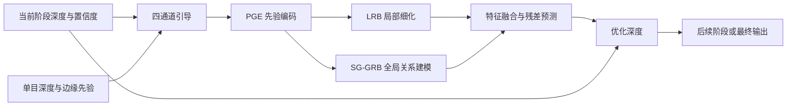

# PLG-MVS

**PLG-MVS 融合单目深度与边缘先验，通过局部细化和全局关系建模优化多视图深度估计。** 本仓库提供 PLG-SGRefiner 深度优化模块、必需的主干代码、DTU 训练与测试入口、BlendedMVS 微调及 Tanks and Temples（TNT）测试入口，以及已有实验结果。

完整版本在四个深度估计阶段均使用优化模块（RefineAll）。代码保留 `MonoMVSNet`、`SGFormerDepthRefiner` 等历史类名，以兼容已有权重。

## 导航

- [方法](#方法)
- [环境与数据准备](#环境与数据准备)
- [DTU 训练与测试](#dtu-训练与测试)
- [BlendedMVS 微调](#blendedmvs-微调)
- [TNT Intermediate 测试](#tnt-intermediate-测试)
- [实验结果](#实验结果)
- [目录与使用说明](#目录与使用说明)
- [来源与许可证](#来源与许可证)

## 方法

### 引导信息与结构

每个阶段将初始 MVS 深度、光度置信度、单目深度和边缘图对齐至当前阶段分辨率，沿通道维拼接。初始深度提供几何估计，置信度提供匹配可靠性，单目深度补充场景结构与相对深度关系，边缘先验提供轮廓线索。单目深度和边缘先验分别由 Depth Anything V2 与 TEED 提供。



下表对应根目录的 **DTU 完整版本**，实现见 [深度优化模块](models/depth_refine_sgformer.py) 和 [模型集成](models/monomvsnet.py)。

| 模块 | 实现 |
|---|---|
| PGE | 两层 3×3 卷积、BatchNorm 和 ReLU，将四通道引导编码为 8 通道特征 |
| LRB | 两层 3×3 卷积、BatchNorm 和 ReLU，提取局部结构 |
| SG-GRB | 对特征进行 Q、K、V 投影，聚合全局关系 |
| 融合层 | 拼接局部与全局特征，通过 1×1 卷积恢复为 8 通道 |
| 残差预测层 | 两层 3×3 卷积预测单通道深度残差 |

DTU 版本先将引导图下采样至当前阶段约 1/16 的高、宽，再执行编码与细化，最后将残差双线性上采样回当前分辨率。其全局分支采用以下计算顺序：

$$
S = K^{\mathsf T}V/N,\qquad O = \operatorname{Proj}(QS),
$$

其中 $N$ 为下采样后的空间位置数。该实现不显式构造 $N\times N$ 注意力矩阵。深度更新为：

$$
\widehat D_s = D_s + 0.05\,\operatorname{Upsample}(R_s).
$$

优化深度替换当前阶段的深度输出，并用于后续阶段的深度采样。

[BlendedMVS/TNT 版本](experiments/blended_tnt/models/depth_refine_sgformer.py) 保留局部与全局分支，在低分辨率全局分支中使用 softmax 注意力，并按深度间隔和置信度限制残差。DTU 与 TNT 测试应分别使用对应入口及与其匹配的权重。

### 训练损失

DTU 完整版本包含四阶段深度分类损失、四阶段深度细化损失，以及最后阶段的单目相对深度一致性损失：

$$
\mathcal L = \sum_{s=1}^{4}\mathcal L_{\mathrm{CE}}^{(s)}
+\sum_{s=1}^{4}\lambda_s\mathcal L_{\mathrm{refine}}^{(s)}
+0.01\mathcal L_{\mathrm{mono}}^{(4)}.
$$

细化项为有效深度区域上的 Smooth L1 损失；单目一致性项约束采样像素对的相对深度关系。

| 损失项 | 权重 |
|---|---|
| 各阶段 CE | `[1, 1, 1, 1]` |
| 各阶段深度细化 | `[0.01, 0.01, 0.02, 0.05]` |
| 最后阶段单目一致性 | `0.01` |

BlendedMVS 微调版本采用自身的损失实现：以当前阶段深度间隔归一化深度误差，再计算 Smooth L1，细化损失权重为 `0.1`。参数见 [结构配置](configs/plg_architecture.json) 与 [微调记录](configs/blended_v4_training_record.json)。

## 环境与数据准备

### 安装环境与先验权重

```bash
git clone https://github.com/1747248153/plgmvs.git
cd plgmvs
conda create -n plgmvs python=3.10 -y
conda activate plgmvs
```

先安装与本机 NVIDIA 驱动、CUDA 环境兼容的 PyTorch 和 torchvision，再安装其余依赖：

```bash
python -m pip install -r requirements.txt
python -c "import torch; print(torch.__version__); print('CUDA available:', torch.cuda.is_available())"
```

按 [先验权重说明](pre_trained_weights/README.md) 准备以下文件：

```text
pre_trained_weights/
├── depth_anything_v2_vits.pth
└── TEED_model.pth
```

仓库提供代码、配置和结果汇总；模型 checkpoint、原始数据、深度图和点云需另行准备。

### 数据目录

DTU 训练使用 MVSNet 格式：

```text
DTU_ROOT/
├── Rectified/scan1_train/rect_001_0_r5000.png
├── Depths_raw/scan1/
│   ├── depth_map_0000.pfm
│   └── depth_visual_0000.png
└── Cameras/
    ├── pair.txt
    └── train/00000000_cam.txt
```

DTU 测试目录以 scan 为单位：

```text
DTU_TEST_ROOT/scan1/
├── images/00000000.jpg
├── cams/00000000_cam.txt
└── pair.txt
```

其余 scan 采用相同结构。测试加载器在存在 `images_post/` 时优先使用该目录，否则使用 `images/`。

BlendedMVS 数据按场景组织：

```text
BLENDED_ROOT/<scene>/
├── blended_images/00000000.jpg
├── rendered_depth_maps/00000000.pfm
└── cams/
    ├── 00000000_cam.txt
    └── pair.txt
```

TNT 路径指向 Intermediate 的场景父目录：

```text
TNT_ROOT/
├── Family/
│   ├── images/00000000.jpg
│   ├── cams/00000000_cam.txt
│   └── new_pair.txt
├── Francis/
├── Horse/
├── Lighthouse/
├── M60/
├── Panther/
├── Playground/
└── Train/
```

数据划分使用仓库 `lists/` 及 `experiments/blended_tnt/lists/` 中的列表。

## DTU 训练与测试

以下命令均在仓库根目录执行。将 `/absolute/path/to/...` 替换为真实路径，推荐为数据、权重和输出目录使用绝对路径。

### 训练完整 PLG

```bash
CUDA_VISIBLE_DEVICES=0 \
DTU_ROOT=/absolute/path/to/dtu_training \
LOG_DIR=/absolute/path/to/checkpoints/plgmvs_dtu \
BATCH_SIZE=4 \
bash scripts/train_dtu_plg.sh
```

| 参数 | 设置 |
|---|---|
| Epoch / Batch size | 15 / 4 |
| 优化器 | Adam，betas `(0.9, 0.999)` |
| 初始学习率 / Weight decay | `0.001` / `0.0001` |
| 学习率衰减 | `10,12,14:2` |
| 训练分辨率上限（高×宽） | `512×640` |
| 输入视图数 | 5 |
| 四阶段深度假设数 | `[8, 8, 4, 4]` |
| Attention temperature | 2 |

默认每个 epoch 保存一次，文件为 `finalmodel_0.ckpt` 至 `finalmodel_14.ckpt`，包含模型、优化器和 epoch 状态。恢复同一训练时，使用同一个 `LOG_DIR`，并在上述命令末尾追加 `--resume`。

历史命令见 [DTU 训练记录](configs/dtu_training_record.json)。

### 深度推理与点云融合

```bash
CUDA_VISIBLE_DEVICES=0 \
DTU_TEST_ROOT=/absolute/path/to/dtu_testing \
PLG_CHECKPOINT=/absolute/path/to/checkpoints/plgmvs_dtu/finalmodel_14.ckpt \
OUT_DIR=/absolute/path/to/outputs/plgmvs_dtu \
bash scripts/test_dtu_plg.sh
```

入口为 [test_dtu_dypcd.py](test_dtu_dypcd.py)。脚本使用 5 个输入视图、batch size 1、`interval_scale=1.06`、`conf=0.55`、四阶段深度假设数 `[8,8,4,4]`，默认分辨率上限为 `832×1152`。

测试生成深度与置信度等推理结果，并执行过滤及点云融合。融合点云位于 `OUT_DIR` 下，例如 `mvsnet001_l3.ply` 对应 scan1。

融合完成后，需使用 DTU 官方点云评估协议、真值点云和观察区域计算 Accuracy、Completeness 与 Overall。本仓库不包含该官方评估工具包；上述脚本不会直接生成官方 Overall。深度图 MAE 也不等同于点云 Overall。

## BlendedMVS 微调

从完整 PLG 的 DTU checkpoint 开始微调：

```bash
CUDA_VISIBLE_DEVICES=0 \
BLENDED_ROOT=/absolute/path/to/BlendedMVS \
DTU_CHECKPOINT=/absolute/path/to/checkpoints/plgmvs_dtu/finalmodel_14.ckpt \
LOG_DIR=/absolute/path/to/checkpoints/plgmvs_blended \
bash scripts/finetune_blended_plg.sh
```

入口为 [train_bld.py](experiments/blended_tnt/train_bld.py)。脚本会切换到实验目录，并在需要时链接根目录的先验权重目录。

| 参数 | 设置 |
|---|---|
| Epoch / Batch size | 6 / 1 |
| 输入视图数 | 9 |
| 分辨率上限（高×宽） | `576×768` |
| Refiner 初始学习率 | `5e-5` |
| 主干学习率比例 | `0.2`，对应初始学习率 `1e-5` |
| 预热 | 第 1 个 epoch 只训练 refiner，之后恢复主干中原本可训练的参数 |
| 学习率衰减 | `3,5:2` |
| Weight decay / 梯度裁剪 | `1e-4` / `1.0` |
| 深度细化损失权重 | `0.1` |
| 其他设置 | 重置残差输出头、冻结 BatchNorm 统计量 |

默认每个 epoch 保存 `finalmodel_N.ckpt`（编号 0–5），并根据验证结果保存 `bestmodel.ckpt`。完整参数见 [BlendedMVS 微调记录](configs/blended_v4_training_record.json)。

## TNT Intermediate 测试

使用与 TNT 版本入口匹配的完整 PLG checkpoint：

```bash
CUDA_VISIBLE_DEVICES=0 \
TNT_ROOT=/absolute/path/to/TankandTemples/intermediate \
PLG_CHECKPOINT=/absolute/path/to/tnt_plg_model.ckpt \
OUT_DIR=/absolute/path/to/outputs/plgmvs_tnt \
bash scripts/test_tnt_plg.sh
```

| 参数 | 设置 |
|---|---|
| 测试列表 | `experiments/blended_tnt/lists/tnt/inter_all.txt` |
| 输入视图数 / 融合视图数 | 21 / 11 |
| Batch size / 数据加载进程数 | 1 / 2 |
| 分辨率上限（高×宽） | `864×1152` |
| 深度假设数 | `[8, 8, 4, 4]` |
| Depth interval ratio | `[0.5, 0.5, 0.5, 0.5]` |
| Interval scale / Attention temperature | `1.06` / `2` |

入口 [test_dypcd_tnt_inter.py](experiments/blended_tnt/test_dypcd_tnt_inter.py) 完成深度推理、过滤和点云融合，最终在 `OUT_DIR` 下得到 `Family.ply`、`Francis.ply`、`Horse.ply`、`Lighthouse.ply`、`M60.ply`、`Panther.ply`、`Playground.ply` 和 `Train.ply`。

官方 F-score 需按 Tanks and Temples 网站的提交流程评估。历史参数见 [TNT 测试记录](configs/tnt_intermediate_record.json)。

## 实验结果

以下为本方法的已有评估记录。本次文档更新没有重新训练或重新提交评估；重跑结果以实际模型版本、权重、数据预处理及评估协议为准。

### DTU

| 方法 | Accuracy↓ | Completeness↓ | Overall↓ |
|---|---:|---:|---:|
| PLG-MVS / PLG-SGRefiner | 0.305817 | 0.252810 | **0.279314** |

Overall 为 Accuracy 与 Completeness 的均值，未舍入值为 `0.2793135`，保留三位小数为 **0.279**。原始记录见 [DTU 评估文件](results/dtu/TotalStat_mvsnet_Eval_.txt)。

### Tanks and Temples Intermediate

| 场景 | F-score（%）↑ |
|---|---:|
| Family | 81.29 |
| Francis | 69.92 |
| Horse | 59.82 |
| Lighthouse | 67.13 |
| M60 | 65.33 |
| Panther | 65.51 |
| Playground | 63.35 |
| Train | 58.87 |
| **Mean** | **66.40** |

数值来自已收到的 Tanks and Temples 官方评估邮件，提交名称为 `MonoMVSNet RefineAll v4`。逐场景记录见 [TNT 结果](results/tnt_intermediate.json)，机器可读汇总见 [结果汇总](results/summary.json)。

## 目录与使用说明

```text
plgmvs/
├── models/                     # 完整 PLG 的 DTU 模型与所需先验网络
├── datasets/                   # DTU 数据加载
├── train_dtu.py                 # DTU 训练
├── test_dtu_dypcd.py            # DTU 推理与融合
├── experiments/blended_tnt/     # BlendedMVS 微调及 TNT 模型、数据与测试入口
├── scripts/                    # 四个运行脚本
├── lists/                      # 数据集划分
├── pre_trained_weights/        # 先验权重放置位置与下载说明
├── configs/                    # 结构配置及历史参数
├── results/                    # DTU 与 TNT 结果记录
└── docs/                       # 来源与版本记录
```

- **路径与工作目录：** 脚本会设置对应运行目录。环境变量建议使用绝对路径，尤其是 BlendedMVS/TNT 的 checkpoint 和输出路径。
- **自定义参数：** 四个脚本均将末尾附加参数传给 Python 入口；改变分辨率、视图数等设置时，请同时记录以便复核结果。
- **PyCharm：** 使用项目对应的 Conda 解释器，在 PyCharm Terminal 的仓库根目录执行上述命令，即可看到训练或测试日志。
- **权重兼容：** 四阶段完整模型与消融版本、DTU 入口与 TNT 入口应分别匹配，不能仅凭文件名判断权重是否适用。

## 来源与许可证

基础多视图主干来自 [MonoMVSNet](https://github.com/JianfeiJ/MonoMVSNet)，单目深度与边缘先验分别使用 [Depth Anything V2](https://github.com/DepthAnything/Depth-Anything-V2) 和 [TEED](https://github.com/xavysp/TEED)。使用本仓库开展研究时，请同时引用相应基础工作。

保留原始 [LICENSE](LICENSE) 及源文件中的作者声明。第三方代码、预训练权重和数据集遵守各自许可证及使用条款。
